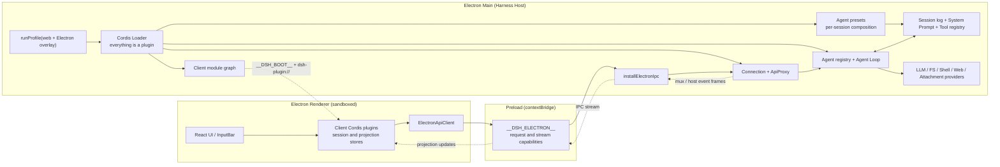
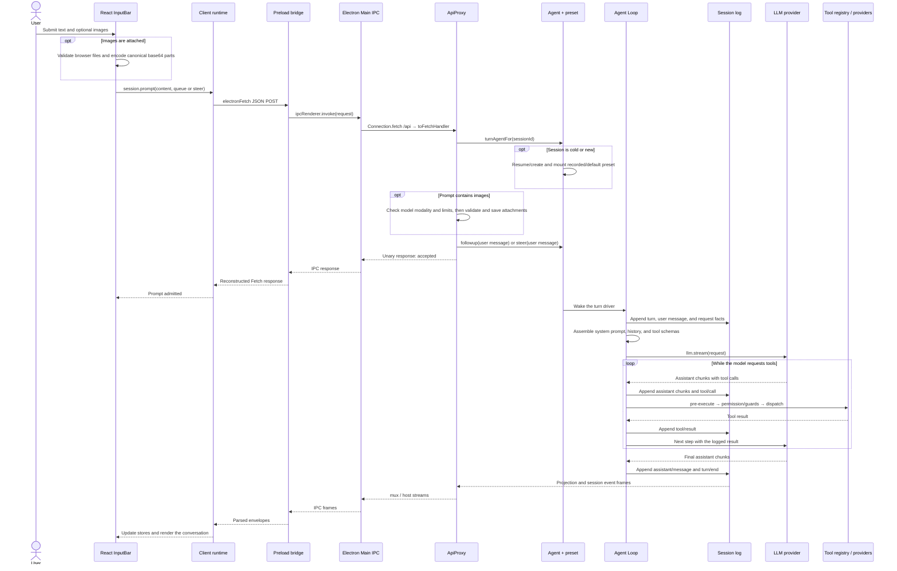

# DeepSeek Harness

English | [中文](README.zh.md)

**Fork notice:** This repository is a fork of [DeepSeek Harness](https://github.com/deepseek-ai/deepseek-harness). It adds an Electron desktop client while retaining the upstream Web and headless applications.

DeepSeek Harness (`dsh`) is an open-source agent harness developed by [DeepSeek AI](https://deepseek.com).

It uses an architecture where **everything is a plugin**, and is powered by [Cordis](https://github.com/cordiverse/cordis), whose design is described in [_A Programming Paradigm for Spatiotemporal Composability_](https://github.com/cordiverse/paper).

## Developer preview

DeepSeek Harness is currently in _developer preview_ and is iterating rapidly. **THERE WILL BE COMPATIBILITY-BREAKING CHANGES.**

## Architecture and request flow

The Electron application runs the complete Harness Host inside Electron Main rather than starting a separate Node.js or HTTP Agent server. Agent Loop, LLM providers, sessions, tools, filesystem, and shell plugins run in Main; the sandboxed Renderer loads the React client through `file://` and communicates through a narrow preload IPC bridge.

The desktop application reuses the `web` profile and its plugin roster with an Electron overlay that disables the HTTP server and Web-only runtime rows. Host-authored client plugins are loaded through the allowlisted `dsh-plugin://` protocol, so the desktop application opens no local port. See the [Electron application reference](apps/electron/README.md) and the [architecture documentation](docs/architecture.md).

The browser and desktop applications are independent surfaces over the same Harness composition; neither transport depends on the other:

| Command | Host | UI transport |
|---|---|---|
| `pnpm dsh web` | Node.js CLI process with `webServer` | Browser HTTP + WebSocket |
| `pnpm electron` | Electron Main with HTTP-only rows disabled | Preload IPC |

### Runtime layout



There are three plugin compositions. Host plugins come from profile bundles, the user's profile patch, and the Electron overlay. Agent plugins come from the selected `agent.cordis.yml` preset and register tools, persona, instructions, and compaction into that preset's scope. Renderer plugins are packages with `dsh.client` metadata; Main builds their boot graph and the client Cordis Loader activates them in the Renderer. Every registration is a Cordis effect, so unloading its plugin removes the contribution.

Packaged Electron keeps configuration paths and package paths separate. Profiles and relative configuration remain under the writable Harness home, while `ctx.dshPackageBaseUrl` makes bare `@deepseek-ai/dsh-*` rows resolve from the packaged application's dependency tree.

The Web application uses the same client plugins, ApiProxy, Agent Loop, and capability providers, but serves `window.__DSH_BOOT__` in `index.html` and uses HTTP/WebSocket carriage. The Electron overlay applies only to the desktop boot and supplies the graph through preload instead; it does not alter the stored Web profile. Headless profiles omit the Renderer and transport layers and invoke the Host directly.

### One prompt, end to end



The `session.prompt` response only confirms admission; assistant text arrives independently through the event stream. The session log is authoritative: model requests, user and assistant messages, tool calls/results, attachment references, and request configuration are recorded so a resumed session can reconstruct the same model-visible state.

For “What is tomorrow's weather in Shanghai?”, Harness does not contain a hardcoded weather route. The model may call the web search tool; `dsh-tool-web` dispatches through `ctx.web` to the configured search provider, the result is logged, and the next model step writes the answer. For local files, model calls pass through the Tool registry's permission and guard stages before `dsh-tool-fs` or `dsh-tool-str-replace-editor` reaches the filesystem service and its sandbox/local provider. For an image prompt, the Renderer owns the temporary `File`, ApiProxy validates and stores the bytes, the log keeps a durable attachment reference, and the LLM adapter receives the image content block.

### Read the source in execution order

1. [`apps/electron/src/main.ts`](apps/electron/src/main.ts) — Electron entry, Host boot, plugin protocol, IPC request and event-stream pumps.
2. [`apps/electron/src/preload.ts`](apps/electron/src/preload.ts) — the only Renderer-to-Main capabilities.
3. [`apps/cli/src/profile-boot.ts`](apps/cli/src/profile-boot.ts) and [`packages/boot/app-boot/src/index.ts`](packages/boot/app-boot/src/index.ts) — profile layers, Cordis Loader, and installed-package resolution.
4. [`packages/client/ui-conversation/src/client/input/hub.ts`](packages/client/ui-conversation/src/client/input/hub.ts), [`packages/client/ui-conversation/src/client/service.ts`](packages/client/ui-conversation/src/client/service.ts), and [`packages/client/runtime/src/client/sessions/session.ts`](packages/client/runtime/src/client/sessions/session.ts) — composer submission, image serialization, and `session.prompt`.
5. [`packages/client/connection/src/client/electron-api-client.ts`](packages/client/connection/src/client/electron-api-client.ts) — Fetch-shaped RPC and event streams over preload IPC.
6. [`packages/host/apiproxy/src/api-proxy.ts`](packages/host/apiproxy/src/api-proxy.ts) — session create/resume, preset selection, attachment admission, prompt dispatch, and projections.
7. [`packages/preset/agent-presets/src/index.ts`](packages/preset/agent-presets/src/index.ts) and [`packages/preset/agent-presets/src/mount.ts`](packages/preset/agent-presets/src/mount.ts) — preset discovery, scoped composition, and bare-package loading.
8. [`packages/core/agent-loop/src/agent.ts`](packages/core/agent-loop/src/agent.ts), [`packages/core/agent-loop/src/tool-calls.ts`](packages/core/agent-loop/src/tool-calls.ts), and [`packages/core/tools/src/index.ts`](packages/core/tools/src/index.ts) — turn/step loop, model streaming, tool policy, execution, and durable results.
9. Follow the selected capability from its tool Consumer to its provider, for example [`packages/web/tool-web/src/search.ts`](packages/web/tool-web/src/search.ts) or [`packages/fs/tool-fs/src/read.ts`](packages/fs/tool-fs/src/read.ts).

## Run

### Run from source

Install Node.js `^22.19.0` or `>=24.0.0`, enable pnpm, and install dependencies from a checkout of this repository:

```sh
pnpm install
```

#### Electron desktop application

Build the required workspace artifacts and start the Electron client:

```sh
pnpm electron
```

Create an unsigned release archive for the current platform:

```sh
pnpm package:electron
```

Archives are written under `dist-exe/electron/`: ZIP on macOS and Windows, and tarball on Linux. Code signing, installers, and auto-update are not configured.

#### Web UI

```sh
pnpm run build
pnpm dsh web
```

The command starts the Web UI at `http://127.0.0.1:3080` by default. See the [Web UI guide](docs/user/guide/index.md).

### Run from `npm`

Run the published upstream package without a checkout:

```sh
npx @deepseek-ai/dsh web
```

## Community and support

- Feel free to submit feedback or bug reports through [GitHub Discussions](https://github.com/deepseek-ai/deepseek-harness/discussions).
- Add the [`dsh-plugin`](https://github.com/topics/dsh-plugin) topic to your plugin repository for discoverability.
- Join <a href="https://discord.gg/Ycq5dCaS4">DeepSeek Harness Discord community</a>.

## Contributing

See [CONTRIBUTING.md](CONTRIBUTING.md).

## Development

Start with the [development guide](docs/development.md) and [architecture documentation](docs/architecture.md).

For agents, follow [AGENTS.md](AGENTS.md).

## License

[MIT](LICENSE)

Third-party dependencies and their licenses are disclosed in [THIRD_PARTY_NOTICES.md](THIRD_PARTY_NOTICES.md).
