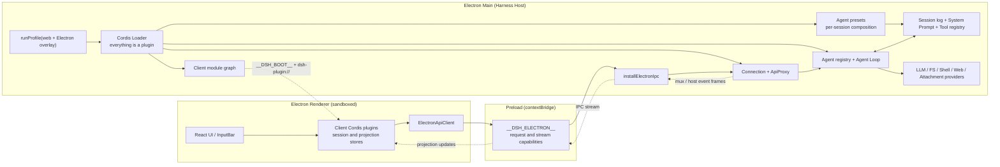
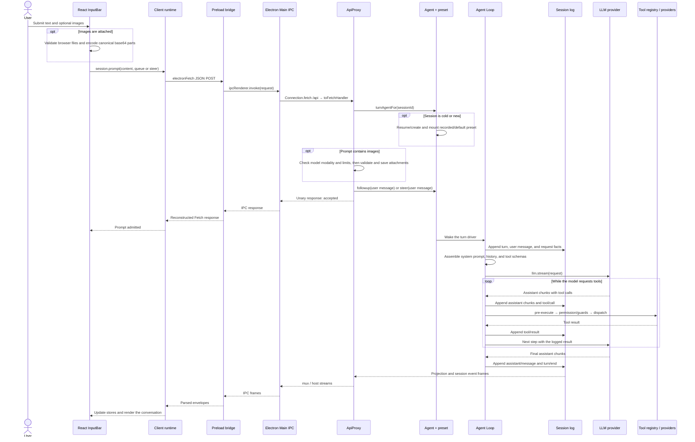

# DeepSeek Harness

[English](README.md) | 中文

**Fork 说明：** 本仓库 fork 自 [DeepSeek Harness](https://github.com/deepseek-ai/deepseek-harness)，在保留上游 Web 与 headless 应用的基础上增加了 Electron 桌面客户端能力。

DeepSeek Harness（`dsh`）是由 [DeepSeek AI](https://deepseek.com) 开发的开源 agent harness（智能体框架）。

它采用**一切皆插件**的架构，并由 [Cordis](https://github.com/cordiverse/cordis) 驱动，其设计参见论文 [_A Programming Paradigm for Spatiotemporal Composability_](https://github.com/cordiverse/paper)。

## 开发者预览

DeepSeek Harness 目前处于 _开发者预览_ 阶段，正在快速迭代。**未来将出现破坏兼容性的变更。**

## 架构与调用链路

Electron 应用直接在 Electron Main 中运行完整的 Harness Host，不会另行启动 Node.js 或 HTTP Agent Server。Agent Loop、LLM provider、会话、工具、文件系统与 shell 插件均运行在 Main；经过 sandbox 的 Renderer 通过 `file://` 加载 React 客户端，并仅通过 preload 暴露的窄 IPC 接口通信。

桌面应用复用 `web` profile 及其插件名单，再通过 Electron overlay 禁用 HTTP 服务器和 Web 专用运行时配置项。Host 组合出的客户端插件经受限的 `dsh-plugin://` 协议加载，因此桌面应用不会打开本地端口。详见 [Electron 应用说明](apps/electron/README.md)与[架构文档](docs/architecture.md)。

浏览器应用与桌面应用是基于同一 Harness 组合的独立入口，两种传输方式互不依赖：

| 命令 | Host | UI 传输 |
|---|---|---|
| `pnpm dsh web` | 挂载 `webServer` 的 Node.js CLI 进程 | 浏览器 HTTP + WebSocket |
| `pnpm electron` | 禁用 HTTP 专用配置项的 Electron Main | Preload IPC |

### 运行时布局



项目里同时存在三套插件组装。Host 插件来自 profile bundle、用户 profile patch 与 Electron overlay；Agent 插件来自选中的 `agent.cordis.yml` preset，把工具、人设、指令与压缩策略注册到该 preset 的 scope；Renderer 插件由带有 `dsh.client` 元数据的包提供，Main 生成启动图，再由客户端 Cordis Loader 在 Renderer 中激活。所有注册都是 Cordis effect，插件卸载时其贡献会一并移除。

打包版 Electron 会把配置路径与包解析路径分开。profile 与相对配置仍位于可写的 Harness home 下，而 `ctx.dshPackageBaseUrl` 让裸 `@deepseek-ai/dsh-*` 配置项从打包应用的依赖树解析。

Web 应用复用同一套客户端插件、ApiProxy、Agent Loop 与能力 provider，但会在 `index.html` 中提供 `window.__DSH_BOOT__`，并使用 HTTP／WebSocket 传输。Electron overlay 仅应用于桌面端启动，改由 preload 提供启动图，不会修改已保存的 Web profile。Headless profile 则不加载 Renderer 和传输层，直接调用 Host。

### 一次对话的完整链路



`session.prompt` 的返回值只表示 Host 已接收请求；assistant 文本通过独立事件流到达。Session 日志是权威事实源：模型请求、用户与 assistant 消息、工具调用／结果、attachment 引用和请求配置都会被记录，因此恢复会话时能够重建相同的模型可见状态。

对于“明天上海的天气怎样？”，Harness 没有硬编码的天气接口。模型可以调用 web search 工具；`dsh-tool-web` 经 `ctx.web` 分发到已配置的搜索 provider，结果写入日志，再由下一次模型 step 生成回答。对于本地文件，模型调用会先经过 Tool 注册表的 permission 与 guard 阶段，再由 `dsh-tool-fs` 或 `dsh-tool-str-replace-editor` 进入文件系统服务及其 sandbox／local provider。对于图片问题，Renderer 持有临时 `File`，ApiProxy 校验并保存字节，日志记录持久 attachment 引用，LLM adapter 最终接收 image 内容块。

### 按执行顺序阅读源码

1. [`apps/electron/src/main.ts`](apps/electron/src/main.ts) —— Electron 入口、Host 启动、插件协议、IPC 请求与事件流泵。
2. [`apps/electron/src/preload.ts`](apps/electron/src/preload.ts) —— Renderer 能够访问的全部 Main 能力。
3. [`apps/cli/src/profile-boot.ts`](apps/cli/src/profile-boot.ts) 与 [`packages/boot/app-boot/src/index.ts`](packages/boot/app-boot/src/index.ts) —— profile 分层、Cordis Loader 与安装包解析基址。
4. [`packages/client/ui-conversation/src/client/input/hub.ts`](packages/client/ui-conversation/src/client/input/hub.ts)、[`packages/client/ui-conversation/src/client/service.ts`](packages/client/ui-conversation/src/client/service.ts) 与 [`packages/client/runtime/src/client/sessions/session.ts`](packages/client/runtime/src/client/sessions/session.ts) —— 输入框提交、图片序列化与 `session.prompt`。
5. [`packages/client/connection/src/client/electron-api-client.ts`](packages/client/connection/src/client/electron-api-client.ts) —— 通过 preload IPC 承载 Fetch 风格 RPC 与事件流。
6. [`packages/host/apiproxy/src/api-proxy.ts`](packages/host/apiproxy/src/api-proxy.ts) —— 会话创建／恢复、preset 选择、attachment 准入、prompt 分发与 projection。
7. [`packages/preset/agent-presets/src/index.ts`](packages/preset/agent-presets/src/index.ts) 与 [`packages/preset/agent-presets/src/mount.ts`](packages/preset/agent-presets/src/mount.ts) —— preset 发现、scope 组装与裸包加载。
8. [`packages/core/agent-loop/src/agent.ts`](packages/core/agent-loop/src/agent.ts)、[`packages/core/agent-loop/src/tool-calls.ts`](packages/core/agent-loop/src/tool-calls.ts) 与 [`packages/core/tools/src/index.ts`](packages/core/tools/src/index.ts) —— turn／step 循环、模型流、工具策略、执行与持久结果。
9. 最后从 Tool Consumer 继续跟到所选能力的 provider，例如 [`packages/web/tool-web/src/search.ts`](packages/web/tool-web/src/search.ts) 或 [`packages/fs/tool-fs/src/read.ts`](packages/fs/tool-fs/src/read.ts)。

## 运行

### 从源码运行

请安装 Node.js `^22.19.0` 或 `>=24.0.0`，启用 pnpm，并在本仓库 checkout 中安装依赖：

```sh
pnpm install
```

#### Electron 桌面应用

构建所需 workspace 产物并启动 Electron 客户端：

```sh
pnpm electron
```

为当前平台生成未签名的发布压缩包：

```sh
pnpm package:electron
```

产物写入 `dist-exe/electron/`：macOS 与 Windows 生成 ZIP，Linux 生成 tarball。代码签名、安装程序和自动更新尚未配置。

#### Web UI

```sh
pnpm run build
pnpm dsh web
```

该命令会启动 Web UI，默认地址为 `http://127.0.0.1:3080`。详见 [Web UI 指南](docs/user/guide/index.md)。

### 通过 `npm` 运行

无需 checkout 即可运行上游已发布的 npm 包：

```sh
npx @deepseek-ai/dsh web
```

## 社区与支持

- 欢迎通过 [GitHub Discussions](https://github.com/deepseek-ai/deepseek-harness/discussions) 提交反馈或 bug 报告。
- 为你的插件仓库添加 [`dsh-plugin`](https://github.com/topics/dsh-plugin) 话题，便于被发现。
- 欢迎加入 DeepSeek Harness 企微群：扫码添加企微小助手并填写入群问卷，完成后小助手会邀请你入群。

<table>
  <thead>
    <tr>
      <th align="center">企微小助手</th>
      <th align="center">入群问卷</th>
      <th align="center">微信公众号</th>
    </tr>
  </thead>
  <tbody>
    <tr>
      <td align="center"></td>
      <td align="center"><a href="https://trtgsjkv6r.feishu.cn/share/base/form/shrcnIt5twSVdLGD52KJBckGCgg"></a></td>
      <td align="center"></td>
    </tr>
  </tbody>
</table>

## 参与贡献

参见 [CONTRIBUTING.md](CONTRIBUTING.md)。

## 开发

请先阅读[开发指南](docs/development.md)与[架构文档](docs/architecture.md)。

面向 agent：请遵循 [AGENTS.md](AGENTS.md)。

## 许可证

[MIT](LICENSE)

第三方依赖及其许可证见 [THIRD_PARTY_NOTICES.md](THIRD_PARTY_NOTICES.md)。
